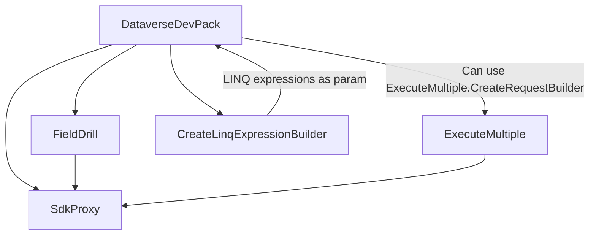

# DevPack4Dataverse

DevPack4Dataverse aka DevPack For Dataverse is a set of instructions built on top of the SDK for Dataverse. Designed with the idea of optimizing and speeding up work with external communication with Dataverse API.
## License

[Apache License 2.0](https://github.com/C485/DevPack4Dataverse/blob/master/LICENSE.md)


# Features



### Connection management
Connections are created in the background. Wait for the required pool size before running work:
```C#
dataverseDevPack.WaitForConnections(4);
await dataverseDevPack.WaitForConnectionsAsync(4, cancellationToken);
```
The synchronous method waits until the count is reached; the asynchronous overload supports cancellation. Both return immediately when the count is already available. They throw `InvalidOperationException` if fewer creators are configured than requested or if the remaining creators fail. A zero count returns immediately. The same methods are available directly on `dataverseDevPack.SdkProxy`.

### ExecuteMultiple
Gives ability to quickly call dataverse endpoint with optimized packs of requests, multiple connections will be used to multiply speed and skip request per minute limits. In example bellow you can see how you can build unlimited in size requests that later will be sent to datavserse endpoint in packs.
```C# 
 Entity[] recordsInCrm = dataverseDevPack.SdkProxy.RetrieveMultiple(new QueryExpression
 {
     EntityName = EntityName,
     ColumnSet = new ColumnSet(false)
 });
 ExecuteMultipleRequestBuilder executeMultipleRequestBuilder = dataverseDevPack.ExecuteMultiple
     .CreateRequestBuilder();
 foreach (var item in recordsInCrm)
 {
     executeMultipleRequestBuilder.AddDelete(item.ToEntityReference());
 }
 ExecuteMultipleLogicResult executeStatistic = await dataverseDevPack.ExecuteMultiple
     .ExecuteAsync(executeMultipleRequestBuilder,
	     new ExecuteMultipleRequestSettings
	     {
	         ErrorReport = (OrganizationRequest obj, string error) => Console.WriteLine($"Error: {error}"),
	         ReportProgress = (int cur, int max) => Console.Title = $"Progress[{cur}/{max}]",
	         ReportProgressInterval = TimeSpan.FromMilliseconds(100)
	     });
```

Production notes:
- Requests are split into chunks of `RequestSize`; it must be greater than zero.
- `Results` are ordered by the original request order, across all chunks. This matters for multi-block file uploads/downloads.
- The full `ExecuteMultipleRequestSettings` overload continues after request failures and reports them through `ErrorReport`; the simple settings overload stops at the first fault.
- `ErrorReport`, `ReportProgress` and the callbacks are optional; `ReportProgressInterval` must be positive.
- The builder is thread-safe and preserves insertion order. A snapshot is taken when execution starts.
- Cancellation returns the partial result with `Cancelled = true` instead of throwing.
- Automatic parallelism uses the available connections but always uses at least one worker.
                
### FieldDrill
Gives ability to go down by lookup fields simply by defining path as string with specified delimiter or by providing path as array of fields.
For example when we have lookup that points to record X, we can call FieldDrill with these parameters
`await dataverseDevPack.FieldDrill.RetreiveAsync<string>(item.ToEntityReference(), "ownerid.fullname");`
It will retrieve field fullname from lookup named ownerid in starting record entity reference.
### SdkProxy
Gives ability to quickly execute any type of request to dataverse endpoint. 
### CreateLinqExpressionBuilder
Gives ability to build expression that later can be used in Where method of early or late bound in OrganizationServiceContext class. In this example we'll try to retrieve 100 records by name. Maximum limit of expressions is 500, it's hard limit specified by SDK.
```C#
ILinqExpressionBuilder<Entity> builder = connectionManager.CreateLinqExpressionBuilder<Entity>();
foreach (string item in Enumerable.Range(1, 100).Select(p => $"Name {p}"))
{
    builder.AddOr(p => p["xx_name"] == item);
}

if (builder.ExpressionsAdded > 0)
{
    Expression<Func<Entity, bool>> finalExpression = builder.Result;
    serviceContext.xxSet.Where(finalExpression).ToArray();
}
```

Production notes:
- Builders are mutable and **not thread-safe**; create one builder per query and use it from a single thread.
- Check `ExpressionsAdded > 0` before using `Result`; an empty builder throws `InvalidOperationException`. If there are no conditions, skip the `Where` call to return unfiltered data.
- Top-level `AddAnd(p => true)` and `AddOr(p => false)` are boolean identities and are ignored. `AddAnd(p => false)` and `AddOr(p => true)` throw `ArgumentException` because the Dataverse LINQ provider cannot translate a generic always-false/always-true filter.
- The Dataverse LINQ provider supports a limited set of expression shapes. The builder combines expression trees but does not validate them; unsupported expressions fail during query translation.
- Adding an empty builder, a builder to itself, or a builder whose `Result` is null throws an exception.


## Roadmap

- Add model to model mapper for integration
- QueryBuilder for faster and better requests / also for LINQ
- LINQ support
- and more...