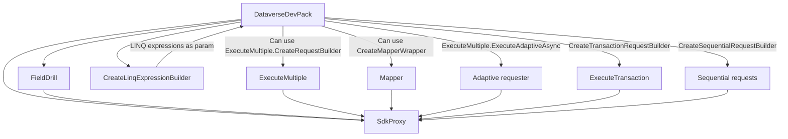

# DevPack4Dataverse

DevPack4Dataverse aka DevPack For Dataverse is a set of instructions built on top of the SDK for Dataverse. Designed with the idea of optimizing and speeding up work with external communication with Dataverse API.

## Supported frameworks

`net462`, `net472`, `net48`, `net8.0`, `net10.0`, `net11.0`

The optional Redis mapper adapters live in the separate `DevPack4Dataverse.Mapper.Redis` project.

## Nullable reference types

All projects enable nullable reference types and treat nullable warnings as errors. Optional values are annotated (`RequestSettings?`, `CachedEntity?`, `EntityKey?`, and similar). See [nullable-breaking-changes.md](nullable-breaking-changes.md) for the annotation changes that can add warnings in NRT-enabled consumers.

## License

[Apache License 2.0](https://github.com/C485/DevPack4Dataverse/blob/master/LICENSE.md)

# Features



### Connection management
Connections are created in the background. Wait for the required pool size before running work:
```C#
dataverseDevPack.WaitForConnections(4);
await dataverseDevPack.WaitForConnectionsAsync(4, cancellationToken);
```
The synchronous method waits until the count is reached; the asynchronous overload supports cancellation. Both return immediately when the count is already available. They throw `InvalidOperationException` if the configured creators cannot produce the requested number or if the remaining creators fail. A zero count returns immediately. The same methods are available directly on `dataverseDevPack.SdkProxy`.

A connection handles one request at a time. The Dataverse caller id is a client-wide setting, so impersonated and ordinary requests cannot safely share a client. Create more connections when you need parallel work. Each creator can create several connections from one authenticated client:

```C#
var creator = new ClientSecretConnectionCreator(
    "https://contoso.crm.dynamics.com",
    appId,
    secret,
    connectionCount: 4);
```

The creator authenticates once, checks the first connection with `WhoAmI`, then clones the client. Each clone is a separate `ServiceClient`, so it can run its own request in parallel. `connectionCount` defaults to 1. Cloning requires an OAuth connection; on-premises AD connections cannot be cloned. Dispose `DataverseDevPack` (or `SdkProxy`) to stop the background creator and close the clients.

### ExecuteMultiple
Gives the ability to quickly call the Dataverse endpoint with optimized packs of requests. Multiple connections are used to increase throughput and avoid request-per-minute limits. In the example below you can build an unlimited number of requests that are later sent to Dataverse in packs.
```C#
 Entity[] recordsInCrm = dataverseDevPack.SdkProxy.RetrieveMultiple(new QueryExpression
 {
     EntityName = EntityName,
     ColumnSet = new ColumnSet(false)
 });
 ExecuteMultipleRequestBuilder executeMultipleRequestBuilder = dataverseDevPack.ExecuteMultiple
     .CreateRequestBuilder();
 foreach (var item in recordsInCrm)
 {
     executeMultipleRequestBuilder.AddDelete(item.ToEntityReference());
 }
 ExecuteMultipleLogicResult executeStatistic = await dataverseDevPack.ExecuteMultiple
     .ExecuteAsync(executeMultipleRequestBuilder,
	     new ExecuteMultipleRequestSettings
	     {
	         ErrorReport = (OrganizationRequest obj, string error) => Console.WriteLine($"Error: {error}"),
	         ReportProgress = (int cur, int max) => Console.Title = $"Progress[{cur}/{max}]",
	         ReportProgressInterval = TimeSpan.FromMilliseconds(100)
	     });
```

Production notes:
- Requests are split into chunks of `RequestSize`; it must be greater than zero and is capped at 1000. When a deployment allows a smaller batch, the fault's `MaxBatchSize` is used to split and resend the chunk automatically.
- `Results` are ordered by the original request order, across all chunks. This matters for multi-block file uploads/downloads. A request that fails at the batch/transport level, or that returns no response, is absent from `Results`; use `ErrorReport` for failures. `RequestIndex` on an item is relative to its own chunk.
- The full `ExecuteMultipleRequestSettings` overload continues after request failures and reports them through `ErrorReport`; the simple settings overload stops at the first fault and throws `ExecuteMultipleException`. Its `Result` property holds the responses collected before the fault and `Fault` holds the failed item, so the caller can resume instead of repeating successful work.
- Both overloads accept an optional `RequestSettings` for the outer batch request, including impersonation and plug-in bypass. Per-message impersonation is rejected because Dataverse applies one caller id to the whole batch.
- `ErrorReport`, `ReportProgress` and the callbacks are optional; `ReportProgressInterval` must be positive. A throwing callback is logged and does not abort the run.
- The builder is thread-safe and preserves insertion order. A snapshot is taken when execution starts. A nested `ExecuteMultipleRequest` is rejected; a batch may contain `ExecuteTransactionRequest` items, as Dataverse allows.
- Cancellation returns the partial result with `Cancelled = true` instead of throwing. The token also cancels the wait for a free connection and the request gate.
- Automatic parallelism uses the available connections but always uses at least one worker.

#### Adaptive execution
For large create/update/delete runs, `ExecuteAdaptiveAsync` adjusts batch size and parallelism while it works:
```C#
ExecuteMultipleLogicResult result = await dataverseDevPack.ExecuteMultiple.ExecuteAdaptiveAsync(
    executeMultipleRequestBuilder,
    new AdaptiveRequesterSettings
    {
        InitialBatchSize = 4,
        InitialDegreeOfParallelism = 4,
        TargetBatchDuration = TimeSpan.FromSeconds(3),
        EvaluationRecordCount = 40
    });
```
It starts with the configured batch size and parallel requests. The first wave is a warm-up and is measured but does not change the settings, so JIT and connection startup do not distort the batch size. Every `EvaluationRecordCount` records it compares the wave duration with `TargetBatchDuration`. Slow waves scale the batch size down toward the target; fast waves grow it. The batch size controls how long one request takes. The degree of parallelism controls throughput, so it is adjusted separately: once the batch size is stable and a wave stays inside the target (or the batch is capped and waves are fast), the requester probes one more parallel request. The probe is kept only when throughput did not regress. If throughput drops or the wave hits a Dataverse service protection limit (error codes `-2147015902`, `-2147015903`, `-2147015898`, or HTTP 429), the probe is rolled back and parallelism stops growing for the run. In short, batch size is tuned for latency, parallelism for throughput. `ErrorReport` and `ReportProgress` work as in the regular ExecuteMultiple path; the progress callback can read `AdaptiveRequesterSettings.CurrentBatchSize` and `CurrentDegreeOfParallelism` for the live values. Results remain ordered by the original request order. `BatchSizeUsed` and `ThreadsUsed` on the result show the final values.

`TargetBatchDuration` is the target for one wave, not for the whole run. A run of N records takes roughly N / (batch size × degree of parallelism) waves, and each wave is kept near the target.

### Bulk operation messages
`SdkProxy` exposes the `CreateMultiple`, `UpdateMultiple`, `UpsertMultiple` and `DeleteMultiple` messages. Each call sends one request to Dataverse:
```C#
EntityCollection targets = new(records)
{
    EntityName = "account"
};

Guid[] ids = await dataverseDevPack.SdkProxy.CreateMultipleAsync(targets);

EntityCollection updates = new(changedRecords) { EntityName = "account" };
await dataverseDevPack.SdkProxy.UpdateMultipleAsync(updates);

UpsertResponse[] upserts = await dataverseDevPack.SdkProxy.UpsertMultipleAsync(altKeyRecords);

EntityReferenceCollection toDelete = new(references);
await dataverseDevPack.SdkProxy.DeleteMultipleAsync(toDelete);
```
Production notes:
- All targets in one call must use the same table. `CreateMultiple` returns ids in the same order as the targets.
- `UpdateMultiple` and `UpsertMultiple` targets must have an id or alternate-key values. Duplicate key values behave differently: `UpdateMultiple` applies the first and ignores later duplicates, while `UpsertMultiple` returns an error.
- `UpsertMultiple` returns one `UpsertResponse` per target. Duplicate key values in one request cause an error.
- `DeleteMultiple` is supported only for elastic tables. For standard tables use `ExecuteMultiple` with delete requests, or `BulkDeleteRequest`.
- On standard tables a bulk request is one transaction: any error rolls back the whole request. On elastic tables partial success is possible; read `Plugin.BulkApiErrorDetails` from the `OrganizationServiceFault.ErrorDetails`.
- Not every standard table supports these messages. The docs show the `sdkmessagefilter` query to check a table.
- Send about 100–1,000 records per request and send requests in parallel. Higher counts can hit the message-size or four-minute request timeout.
- `RequestSettings` still applies, including impersonation, `BypassCustomPluginExecution` and `ConcurrencyBehavior` for `UpdateMultiple`.
- These messages are not supported inside plug-ins.

#### Chunked execution
`DataverseDevPack.BulkOperation` sends the same messages in chunks and uses the connection pool:
```C#
Guid[] ids = await dataverseDevPack.BulkOperation.CreateMultipleAsync(
    records,
    new BulkOperationSettings
    {
        BatchSize = 1000,
        MaxDegreeOfParallelism = 4,
        ReportProgress = (current, total) => Console.WriteLine($"{current}/{total}")
    },
    new RequestSettings { ImpersonateAsUserByDataverseId = userId });
```
The same overloads exist for `UpdateMultipleAsync`, `UpsertMultipleAsync` and `DeleteMultipleAsync`. Results are merged in the original input order. `MaxDegreeOfParallelism = 0` uses the number of available connections. Each chunk is one request, so on a standard table a failed chunk rolls back only that chunk and earlier chunks stay committed. When a chunk throws, the original exception is rethrown and `Exception.Data` contains `BulkOperationLogic.FailedChunkStartIndexDataKey` and `FailedChunkCountDataKey`.

### ExecuteTransaction
Executes all requests as one atomic database transaction. If any request fails, Dataverse rolls back every change and the fault identifies the failed request index:
```C#
ExecuteTransactionRequestBuilder transaction = dataverseDevPack.CreateTransactionRequestBuilder();
transaction.AddCreate(new Entity("account") { ["name"] = "Account 1" });
transaction.AddCreate(new Entity("account") { ["name"] = "Account 2" });

try
{
    ExecuteTransactionResponse response = await dataverseDevPack.SdkProxy.ExecuteAsync(transaction);
    Guid createdId = (Guid)response.Responses[0].Results["id"];
}
catch (FaultException<OrganizationServiceFault> fault)
{
    int failedRequestIndex = ((ExecuteTransactionFault)fault.Detail).FaultedRequestIndex;
    throw;
}
```
Requests execute in insertion order. `ReturnResponses` is `true` by default; pass `false` to `CreateTransactionRequestBuilder` when responses are not needed. A transaction cannot contain an `ExecuteMultipleRequest` or another `ExecuteTransactionRequest`; the builder rejects both. The builder is thread-safe and a snapshot is taken when execution starts.

### Sequential requests
Executes request steps one after another. Each step can read the results of every previous step from the `SequentialRequestContext` passed to its factory:
```C#
SequentialRequestContext results = await dataverseDevPack
    .CreateSequentialRequestBuilder()
    .Create(new Entity("account") { ["name"] = "Contoso" })
    .ExecuteAction(
        "new_Action",
        context => new EntityReference("account", context.CreatedId(0)),
        (context, request) => request["flag"] = true)
    .Retrieve(
        "account",
        context => context.CreatedId(0),
        new ColumnSet("name"))
    .ExecuteAsync();

// Inner logic with access to the results of steps 0, 1 and 2.
Guid createdId = results.CreatedId(0);
OrganizationResponse actionResponse = results.Response<OrganizationResponse>(1);
Entity retrieved = results.RetrievedEntity(2);
```
Step indexes are zero-based. `Execute()` provides the synchronous variant and `ExecuteAsync(cancellationToken)` the asynchronous one. Steps stop at the first exception; there is no automatic transaction or rollback. The builder is mutable and not thread-safe, so create one builder per sequence. The same context is available to step factories through `CreatedId`, `RetrievedEntity`, `Response<T>`, indexing and `Last`.

### Mapper
Maps POCO or `Entity` sources to `Entity` or POCO targets. Stages run in order against the same target, so later stages can read earlier values. Lookups can resolve by basic key (`logicalName` + `Guid`) or Dataverse alternate key.
```C#
MapperWrapper mapperWrapper = dataverseDevPack.CreateMapperWrapper(
    new MapperWrapperOptions
    {
        DefaultCacheTtl = TimeSpan.FromMinutes(10),
        LockTimeout = TimeSpan.FromSeconds(20)
    });

Mapper<Order, Entity> mapper = mapperWrapper
    .CreateMapperBuilder<Order, Entity>("order")
    .WithLogicalName("new_order")
    .WithEntityKey(context => EntityKey.ById("new_order", context.Source.Id))
    .Map("new_name", context => context.Source.Name)
    .MapLookup(
        "new_customerid",
        context => EntityKey.ByAlternateKey(
            "account",
            new KeyValuePair<string, object>("accountnumber", context.Source.AccountNumber)),
        new LookupMappingOptions
        {
            Fields = { "name", "accountnumber" },
            AlternateKeyAttributes = { "accountnumber" },
            RetrievalMode = LookupRetrievalMode.RetrieveAllRecords,
            CreateIfNotExists = true
        },
        context => new Entity("account") { ["name"] = context.Source.CustomerName })
    .NextStage()
    .Map("new_summary", context =>
        context.Target.GetAttributeValue<string>("new_name") + " / " + context.Source.Region)
    .WithOptions(options =>
    {
        options.RequestSettings.ImpersonateAsUserByDataverseId = userId;
        options.RequestSettings.ImpersonateAsUserByAADId = userAadObjectId;
        options.RequestSettings.SkipPluginExecution = true;
        options.SkipFieldsToChanged.Add("modifiedon");
        options.PreSave = context => context.Target["new_name"] = context.Target
            .GetAttributeValue<string>("new_name")
            ?.Trim();
        options.ValidateAfterSave = true;
        options.ValidationFields.Add("new_name");
        options.Validator = (record, validationContext) =>
            string.IsNullOrWhiteSpace(record.GetAttributeValue<string>("new_name"))
                ? new[] { "Name is required." }
                : Array.Empty<string>();
    })
    .Build();

MappingResult<Entity> result = await mapper.ExecuteAsync(order);

// Force a fresh lookup read and refresh cached entries for this run:
await mapper.ExecuteAsync(order, new MappingRunOptions { ForceRefresh = true });
```
Every lookup mapping has its own options:
- `UseCache`
- `RetrievalMode`: `OneByOne` or `RetrieveAllRecords`
- `CreateIfNotExists`
- `ThrowIfEmpty`
- `ThrowIfNotFound`
- `Fields` and `AlternateKeyAttributes`; only these columns are retrieved, and missing fields on a cached record are fetched individually.
- Force refresh is set per run through `MappingRunOptions.ForceRefresh`.

Mapper behaviour:
- `PreSave` runs before change detection.
- `SkipFieldsToChanged` ignores fields when deciding whether an update is needed.
- Change detection reads the current record fresh from Dataverse by default. Set `UseCacheForChangeDetection = true` to allow the cache and accept possible staleness. The primary key attribute is read from table metadata, so activity tables such as `email` and `task` use `activityid`.
- A blank alternate key is rejected before any read; an alternate key that matches more than one record throws `MapperException` instead of picking one.
- `RetrieveAllRecords` preloads are reused across runs of the same mapper until the wrapper cache TTL expires; use `MappingRunOptions.ForceRefresh` to reload.
- When impersonating, set both `ImpersonateAsUserByDataverseId` and `ImpersonateAsUserByAADId` when available. On some tenants the Dataverse id alone authorizes the call but the record's `createdby` stays the application user.
- Only changed attributes are sent on update; unchanged records are skipped. For an alternate-key upsert, key columns are removed from the body so the key value always wins.
- `LookupMappingOptions` is copied at `Build`; later changes to the options object do not affect a built mapper.
- Validation errors are collected in `MappingResult.Errors`. When validation is enabled, saved records are read fresh from Dataverse, bypassing cache, using only the configured validation fields. Multiple saved records are read in batches.
- `MappingRunOptions.ValidateAfterSave = false` also suppresses wrapper validation for that run.
- POCO targets need an `IModelEntityConverter<TModel>` through `WithConverter` when they must be saved or validated.

`MapperWrapper` is the global mapper container. It owns shared cache, lock, and wrapper-level validation:
```C#
mapperWrapper.Register("order", mapper);
MapperWrapperResult wrapperResult = await mapperWrapper.ExecuteAsync("order", order);

// Run several registered mappers as one batch and validate the combined records once.
MapperBatchResult batchResult = await mapperWrapper.ExecuteAllAsync(
    new[]
    {
        new MapperExecution("order", order),
        new MapperExecution("order-line", line)
    });
```
Wrapper validation can use one global field set or per-table field sets:
```C#
mapperWrapper.Options.ValidationFieldsByEntity["account"] = new HashSet<string> { "name" };
mapperWrapper.Options.ValidationFieldsByEntity["contact"] = new HashSet<string> { "email" };
```
If the mapper already ran `ValidateAfterSave`, wrapper validation is skipped to avoid duplicate reads. Set `MapperWrapperOptions.ValidateAfterMapperValidation = true` when both validators must run.
The default cache and lock are in-memory. External implementations can be injected through `IEntityCache` and `IEntityLock` on the `MapperWrapper` constructor; the optional `DevPack4Dataverse.Mapper.Redis` project provides `RedisEntityCache` and `RedisEntityLock`:
```C#
IConnectionMultiplexer redis = await ConnectionMultiplexer.ConnectAsync("localhost");
MapperWrapper redisWrapper = new(
    dataverseDevPack.SdkProxy,
    logger,
    new MapperWrapperOptions { LockTimeout = TimeSpan.FromSeconds(20) },
    new RedisEntityCache(redis),
    new RedisEntityLock(redis));
```
Redis remains an optional project and ships as the `DevPack4Dataverse.Mapper.Redis` package. Cache TTL is configured per logical table name through `MapperWrapperOptions.CacheTtlByEntity`, and the lock timeout is configured globally. `RedisEntityLock` accepts a separate `lockTimeToLive` value (default five minutes) and renews it while the handle is alive, so a long save keeps mutual exclusion. Release failures are ignored because the TTL cleans up. Use a unique key prefix per environment when several environments share one Redis. Wrapper validation uses `MapperWrapperOptions.Validator` and requires `ValidationFields` or `ValidationFieldsByEntity` to declare the columns the validator needs. Redis cache serialization supports common attribute types; unsupported attribute types fail explicitly instead of being silently cached. The Redis cache and lock integration tests run only when `DEVPACK_REDIS_CONNECTION` is set, for example `127.0.0.1:6390,allowAdmin=true` for a local Docker Redis.

### FieldDrill
Gives ability to go down by lookup fields simply by defining path as string with specified delimiter or by providing path as array of fields.
For example when we have lookup that points to record X, we can call FieldDrill with these parameters
`await dataverseDevPack.FieldDrill.RetreiveAsync<string>(item.ToEntityReference(), "ownerid.fullname");`
It will retrieve field fullname from lookup named ownerid in starting record entity reference.
### Money fields
`FieldMethods.MoneyFieldTypeMethods` provides helpers for transaction-currency and base-currency amounts:
```C#
MoneyFieldTypeMethods money = dataverseDevPack.FieldMethods.MoneyFieldTypeMethods;

money.SetValue(account, "creditlimit", 1500m);
decimal? amount = money.GetValue(account, "creditlimit");
decimal? baseAmount = money.GetBaseValue(account, "creditlimit");

decimal exchangeRate = await money.GetExchangeRateAsync(account);
decimal baseValue = money.ConvertToBase(amount.Value, exchangeRate);
decimal transactionValue = money.ConvertFromBase(baseValue, exchangeRate);

string formatted = money.GetFormattedValue(account, "creditlimit");
```
`SetValue` sets only the transaction Money field; Dataverse calculates the read-only `<field>_base` field when the record is saved. The base value formula is `transaction amount / exchange rate`. If the record does not contain `exchangerate`, `GetExchangeRate` and `GetExchangeRateAsync` retrieve it from the transaction currency record. `SetTransactionCurrency` and `GetTransactionCurrency` work with the `transactioncurrencyid` lookup.

Choice label metadata is cached for five minutes per table and column. Recreate the `FieldMethods` instance, or wait for the TTL, to see metadata changes immediately.

`FileOrImageFieldTypeMethods.Delete(record, field)` reads the file id stored on the record. Image columns do not return that id in a normal retrieve; for images, keep `UploadFileFieldResult.FileId` and call `Delete(fileId)`.

### SdkProxy
Gives ability to quickly execute any type of request to dataverse endpoint.

`RetrieveMultiple` and `RetrieveMultipleAsync` page through all rows when the query has no `PageInfo`. If the caller supplies `PageInfo`, exactly that page is returned and the caller's paging values are left unchanged. Add an `Orders` entry for stable paging; without one, Dataverse can return the same row on two pages or skip a row.

`GetConnection`, `GetConnectionAsync` and `ExecuteAsync<T>` accept a `CancellationToken`, so a caller waiting for a free connection can stop.

`SdkProxy.ApplyProcessWideOptimizations()` is an opt-in static method for the legacy process-wide HTTP and thread-pool tuning. The library does not call it; call it once at host startup if you want those settings. On .NET 8 and later only the thread-pool part applies.

### CreateLinqExpressionBuilder
Gives ability to build expression that later can be used in Where method of early or late bound in OrganizationServiceContext class. In this example we'll try to retrieve 100 records by name. Maximum limit of expressions is 500, it's hard limit specified by SDK.
```C#
ILinqExpressionBuilder<Entity> builder = connectionManager.CreateLinqExpressionBuilder<Entity>();
foreach (string item in Enumerable.Range(1, 100).Select(p => $"Name {p}"))
{
    builder.AddOr(p => p["xx_name"] == item);
}

if (builder.ExpressionsAdded > 0)
{
    Expression<Func<Entity, bool>> finalExpression = builder.Result;
    serviceContext.xxSet.Where(finalExpression).ToArray();
}
```

Production notes:
- Builders are mutable and **not thread-safe**; create one builder per query and use it from a single thread.
- `AddAnd` and `AddOr` combine the new expression with everything added before it, left to right: `(existing) OR (new)`. To express `tenant AND (a OR b)`, build `a OR b` in a separate builder and pass it to `AddAnd`.
- Check `ExpressionsAdded > 0` before using `Result`; an empty builder throws `InvalidOperationException`. If there are no conditions, skip the `Where` call to return unfiltered data.
- Top-level `AddAnd(p => true)` and `AddOr(p => false)` are boolean identities and are ignored. `AddAnd(p => false)` and `AddOr(p => true)` throw `ArgumentException` because the Dataverse LINQ provider cannot translate a generic always-false/always-true filter.
- The Dataverse LINQ provider supports a limited set of expression shapes. The builder combines expression trees but does not validate them; unsupported expressions fail during query translation.
- The 500 limit counts builder expressions. A single expression with many `&&`/`||` conditions can still exceed the Dataverse limit of 500 conditions and links.
- Adding an empty builder, a builder to itself, or a builder whose `Result` is null throws an exception.

## Audit and live-test fixes

This pass addressed the findings below and validated the library against a live Dataverse environment. The unit suite has 376 tests and runs on `net8.0`, `net11.0`, and `net48` (10 Redis cache and lock integration tests skip unless `DEVPACK_REDIS_CONNECTION` is set), all target frameworks build, and the NuGet restore reports no known vulnerable-package warnings.

### Security and correctness
- A failed connection pool fails fast instead of looping forever when every connection creator has errored.
- Caller-id impersonation is serialized per connection, so a shared `ServiceClient` cannot run a request as the wrong user or leave the impersonation behind. Set both `ImpersonateAsUserByDataverseId` and `ImpersonateAsUserByAADId` when available; on some tenants the Dataverse id alone authorizes the call but the record's `createdby` stays the application user.
- Deleting a missing file/image returns `false` instead of throwing. For image columns, keep the `FileId` returned by `Upload` and call `Delete(fileId)`; image values are not returned by a normal retrieve.
- Finalizers tolerate a failed constructor, so a null-argument guard cannot crash the process later.
- The transitive `System.Security.Cryptography.Pkcs` and `System.Security.Cryptography.Xml` packages are pinned to patched versions.
- Mapper reads and validation use `<logicalname>id` instead of the invalid `entityid`, and no longer combine `TopCount` with paging. This was found on a custom table.
- File upload block ids avoid `+`, which Dataverse decodes as a space in the blockid query value.
- Lookups honor `UseCache=false` in the create-race recheck.
- Alternate-key cache and lock keys are length-prefixed, so values containing `;` or `=` cannot collide.
- Language-specific option-set label lookup is case-insensitive by default again.
- `Mapper` clones its options at `Build`; later builder changes do not mutate a live mapper.
- `RequestSize` is capped at 1,000. `ExecuteMultiple` results document that transport-failed or no-response requests are absent and that `RequestIndex` is chunk-local.
- `Connection.DeleteRecordAsync(EntityReference)` has the same null guard as the sync overload; `FieldDrill` trims path segments.
- `DataverseDevPack` implements `IDisposable` and exposes `DisposeAsync`.

### Caching and performance
- `Statistics` keeps a bounded 2-minute bucket ring instead of scanning up to 100,000 entries per connection choice.
- Option-set metadata is cached for five minutes per table and column using a case-insensitive tuple key; label lookup no longer uses LINQ per cell.
- `RetrieveAllRecords` preloads are reused across runs of the same mapper until the cache TTL expires; `ForceRefresh` still reloads.
- Redis preload writes run with bounded parallelism; reference parsing avoids `string.Split` and DTO lists are pre-sized.
- `SdkProxy` does not change process-wide `ThreadPool` and `ServicePointManager` settings by default; `SdkProxy.ApplyProcessWideOptimizations()` is the explicit opt-in.
- Batch boundaries log success, failure and real elapsed time through `OperationLogger`; the unused `EntryExitLogger` helper was removed.
- Mapper per-record collections are reduced: lazy error lists, a single required-column pass, shared loaded-column sets, and no per-record LINQ in the cache and field paths.
- The in-memory cache reuses its completed read task instead of allocating a `Task` per hit.
- Entity keys normalize names at construction; key building uses a sized `StringBuilder` and an array sort instead of LINQ. `FieldDrill` path trimming and cache clearing use plain loops, and an alternate-key two-pair overload avoids the `params` array.
- Removed the double statistics entry for sync `ExecuteMultiple` and two dead project lines.

### Hardening pass
- Mapper reads the primary id attribute from metadata (activity tables now work); blank alternate keys and multi-match lookups throw; alternate-key upserts remove key columns from the body; lookup options are copied at `Build`.
- Bulk operation messages `CreateMultiple`, `UpdateMultiple`, `UpsertMultiple` and `DeleteMultiple` are exposed on `SdkProxy` and `Connection`, with same-table and identity validation.
- `BulkOperation` chunks records (default 1,000), runs chunks in parallel across the pool, merges ids/results in input order, reports progress and adds the failed chunk index/count to the exception.
- A connection is always exclusive. `maximumConcurrentlyUsage` is gone; one creator can produce several cloned connections with `connectionCount`, so the pool gets real parallel clients instead of extra permits on one client.
- `ExecuteMultiple` splits a chunk when the deployment returns `MaxBatchSize`, preserves partial results in `ExecuteMultipleException`, rejects nested `ExecuteMultipleRequest` items and per-message impersonation, and ignores throwing progress callbacks.
- Cancellation reaches the connection wait and call gate; `Dispose` waits for active leases before closing clients.
- `RetrieveMultiple` respects caller `PageInfo`; connection strings parse `RequireNewInstance` with spaces; `Test` is serialized with caller-id changes.
- `ConnectionLease` construction is internal; use the proxy methods instead of running raw client calls on a pooled client.
- Redis cache preserves date-only values, null attributes and formatted values; the lock renews its TTL and ignores release failures; zero TTL means no caching.
- Statistics total usage accumulates milliseconds instead of whole seconds.

### Live validation
Validated on a live Dataverse environment with fake data on a test table that has choice, boolean, money, file, image and self-lookup columns:
- CRUD, `ExecuteMultiple`, sequential, transaction, mapper create/update/validation/lookups, `FieldDrill`, choice, boolean, money, file, image, LINQ and impersonation all passed.
- 5,000 records with regular `ExecuteMultiple`, one connection: **1:55.6** (about 43 records/sec).
- 5,000 records with adaptive `ExecuteMultiple`, four connections, 3-second target: **50.0s**, **100 records/sec**, 0 errors, final batch 54 × 4 threads.
- 5,000-record download: **0.665s**.
- All test records were removed after validation.

## Roadmap

- QueryBuilder for faster and better requests / also for LINQ
- and more...