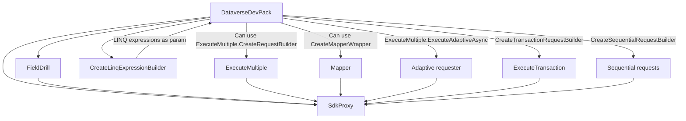

# DevPack4Dataverse

DevPack4Dataverse aka DevPack For Dataverse is a set of instructions built on top of the SDK for Dataverse. Designed with the idea of optimizing and speeding up work with external communication with Dataverse API.

## Supported frameworks

`net462`, `net472`, `net48`, `net8.0`, `net10.0`

The optional Redis mapper adapters live in the separate `DevPack4Dataverse.Mapper.Redis` project.

## License

[Apache License 2.0](https://github.com/C485/DevPack4Dataverse/blob/master/LICENSE.md)

# Features



### Connection management
Connections are created in the background. Wait for the required pool size before running work:
```C#
dataverseDevPack.WaitForConnections(4);
await dataverseDevPack.WaitForConnectionsAsync(4, cancellationToken);
```
The synchronous method waits until the count is reached; the asynchronous overload supports cancellation. Both return immediately when the count is already available. They throw `InvalidOperationException` if fewer creators are configured than requested or if the remaining creators fail. A zero count returns immediately. The same methods are available directly on `dataverseDevPack.SdkProxy`.

A connection handles one request at a time. The Dataverse caller id is a client-wide setting, so impersonated and ordinary requests cannot safely share a client; create more connections when you need parallel work. Dispose `DataverseDevPack` (or `SdkProxy`) to stop the background creator and close the clients.

### ExecuteMultiple
Gives the ability to quickly call the Dataverse endpoint with optimized packs of requests. Multiple connections are used to increase throughput and avoid request-per-minute limits. In the example below you can build an unlimited number of requests that are later sent to Dataverse in packs.
```C#
 Entity[] recordsInCrm = dataverseDevPack.SdkProxy.RetrieveMultiple(new QueryExpression
 {
     EntityName = EntityName,
     ColumnSet = new ColumnSet(false)
 });
 ExecuteMultipleRequestBuilder executeMultipleRequestBuilder = dataverseDevPack.ExecuteMultiple
     .CreateRequestBuilder();
 foreach (var item in recordsInCrm)
 {
     executeMultipleRequestBuilder.AddDelete(item.ToEntityReference());
 }
 ExecuteMultipleLogicResult executeStatistic = await dataverseDevPack.ExecuteMultiple
     .ExecuteAsync(executeMultipleRequestBuilder,
	     new ExecuteMultipleRequestSettings
	     {
	         ErrorReport = (OrganizationRequest obj, string error) => Console.WriteLine($"Error: {error}"),
	         ReportProgress = (int cur, int max) => Console.Title = $"Progress[{cur}/{max}]",
	         ReportProgressInterval = TimeSpan.FromMilliseconds(100)
	     });
```

Production notes:
- Requests are split into chunks of `RequestSize`; it must be greater than zero and is capped at 1000. A Dataverse deployment can allow a smaller batch.
- `Results` are ordered by the original request order, across all chunks. This matters for multi-block file uploads/downloads. A request that fails at the batch/transport level, or that returns no response, is absent from `Results`; use `ErrorReport` for failures. `RequestIndex` on an item is relative to its own chunk.
- The full `ExecuteMultipleRequestSettings` overload continues after request failures and reports them through `ErrorReport`; the simple settings overload stops at the first fault and runs chunks sequentially.
- Both overloads accept an optional `RequestSettings` for the outer batch request, including impersonation and plug-in bypass.
- `ErrorReport`, `ReportProgress` and the callbacks are optional; `ReportProgressInterval` must be positive.
- The builder is thread-safe and preserves insertion order. A snapshot is taken when execution starts.
- Cancellation returns the partial result with `Cancelled = true` instead of throwing.
- Automatic parallelism uses the available connections but always uses at least one worker.

#### Adaptive execution
For large create/update/delete runs, `ExecuteAdaptiveAsync` adjusts batch size and parallelism while it works:
```C#
ExecuteMultipleLogicResult result = await dataverseDevPack.ExecuteMultiple.ExecuteAdaptiveAsync(
    executeMultipleRequestBuilder,
    new AdaptiveRequesterSettings
    {
        InitialBatchSize = 4,
        InitialDegreeOfParallelism = 4,
        TargetBatchDuration = TimeSpan.FromSeconds(3),
        EvaluationRecordCount = 40
    });
```
It starts with the configured batch size and parallel requests. Every `EvaluationRecordCount` records it compares the wave duration with `TargetBatchDuration`. Slow waves reduce the batch size first, then parallelism; fast waves increase the batch size first, then parallelism. `ErrorReport` and `ReportProgress` work as in the regular ExecuteMultiple path. Results remain ordered by the original request order. `BatchSizeUsed` and `ThreadsUsed` on the result show the final values.

### ExecuteTransaction
Executes all requests as one atomic database transaction. If any request fails, Dataverse rolls back every change and the fault identifies the failed request index:
```C#
ExecuteTransactionRequestBuilder transaction = dataverseDevPack.CreateTransactionRequestBuilder();
transaction.AddCreate(new Entity("account") { ["name"] = "Account 1" });
transaction.AddCreate(new Entity("account") { ["name"] = "Account 2" });

try
{
    ExecuteTransactionResponse response = await dataverseDevPack.SdkProxy.ExecuteAsync(transaction);
    Guid createdId = (Guid)response.Responses[0].Results["id"];
}
catch (FaultException<OrganizationServiceFault> fault)
{
    int failedRequestIndex = ((ExecuteTransactionFault)fault.Detail).FaultedRequestIndex;
    throw;
}
```
Requests execute in insertion order. `ReturnResponses` is `true` by default; pass `false` to `CreateTransactionRequestBuilder` when responses are not needed. A transaction cannot contain an `ExecuteMultipleRequest` or another `ExecuteTransactionRequest`; the builder rejects both. The builder is thread-safe and a snapshot is taken when execution starts.

### Sequential requests
Executes request steps one after another. Each step can read the results of every previous step from the `SequentialRequestContext` passed to its factory:
```C#
SequentialRequestContext results = await dataverseDevPack
    .CreateSequentialRequestBuilder()
    .Create(new Entity("account") { ["name"] = "Contoso" })
    .ExecuteAction(
        "new_Action",
        context => new EntityReference("account", context.CreatedId(0)),
        (context, request) => request["flag"] = true)
    .Retrieve(
        "account",
        context => context.CreatedId(0),
        new ColumnSet("name"))
    .ExecuteAsync();

// Inner logic with access to the results of steps 0, 1 and 2.
Guid createdId = results.CreatedId(0);
OrganizationResponse actionResponse = results.Response<OrganizationResponse>(1);
Entity retrieved = results.RetrievedEntity(2);
```
Step indexes are zero-based. `Execute()` provides the synchronous variant and `ExecuteAsync(cancellationToken)` the asynchronous one. Steps stop at the first exception; there is no automatic transaction or rollback. The builder is mutable and not thread-safe, so create one builder per sequence. The same context is available to step factories through `CreatedId`, `RetrievedEntity`, `Response<T>`, indexing and `Last`.

### Mapper
Maps POCO or `Entity` sources to `Entity` or POCO targets. Stages run in order against the same target, so later stages can read earlier values. Lookups can resolve by basic key (`logicalName` + `Guid`) or Dataverse alternate key.
```C#
MapperWrapper mapperWrapper = dataverseDevPack.CreateMapperWrapper(
    new MapperWrapperOptions
    {
        DefaultCacheTtl = TimeSpan.FromMinutes(10),
        LockTimeout = TimeSpan.FromSeconds(20)
    });

Mapper<Order, Entity> mapper = mapperWrapper
    .CreateMapperBuilder<Order, Entity>("order")
    .WithLogicalName("new_order")
    .WithEntityKey(context => EntityKey.ById("new_order", context.Source.Id))
    .Map("new_name", context => context.Source.Name)
    .MapLookup(
        "new_customerid",
        context => EntityKey.ByAlternateKey(
            "account",
            new KeyValuePair<string, object>("accountnumber", context.Source.AccountNumber)),
        new LookupMappingOptions
        {
            Fields = { "name", "accountnumber" },
            AlternateKeyAttributes = { "accountnumber" },
            RetrievalMode = LookupRetrievalMode.RetrieveAllRecords,
            CreateIfNotExists = true
        },
        context => new Entity("account") { ["name"] = context.Source.CustomerName })
    .NextStage()
    .Map("new_summary", context =>
        context.Target.GetAttributeValue<string>("new_name") + " / " + context.Source.Region)
    .WithOptions(options =>
    {
        options.RequestSettings.ImpersonateAsUserByDataverseId = userId;
        options.RequestSettings.SkipPluginExecution = true;
        options.SkipFieldsToChanged.Add("modifiedon");
        options.PreSave = context => context.Target["new_name"] = context.Target
            .GetAttributeValue<string>("new_name")
            ?.Trim();
        options.ValidateAfterSave = true;
        options.ValidationFields.Add("new_name");
        options.Validator = (record, validationContext) =>
            string.IsNullOrWhiteSpace(record.GetAttributeValue<string>("new_name"))
                ? new[] { "Name is required." }
                : Array.Empty<string>();
    })
    .Build();

MappingResult<Entity> result = await mapper.ExecuteAsync(order);

// Force a fresh lookup read and refresh cached entries for this run:
await mapper.ExecuteAsync(order, new MappingRunOptions { ForceRefresh = true });
```
Every lookup mapping has its own options:
- `UseCache`
- `RetrievalMode`: `OneByOne` or `RetrieveAllRecords`
- `CreateIfNotExists`
- `ThrowIfEmpty`
- `ThrowIfNotFound`
- `Fields` and `AlternateKeyAttributes`; only these columns are retrieved, and missing fields on a cached record are fetched individually.
- Force refresh is set per run through `MappingRunOptions.ForceRefresh`.

Mapper behaviour:
- `PreSave` runs before change detection.
- `SkipFieldsToChanged` ignores fields when deciding whether an update is needed.
- Change detection reads the current record fresh from Dataverse by default. Set `UseCacheForChangeDetection = true` to allow the cache and accept possible staleness.
- `RetrieveAllRecords` preloads are reused across runs of the same mapper until the wrapper cache TTL expires; use `MappingRunOptions.ForceRefresh` to reload.
- Only changed attributes are sent on update; unchanged records are skipped.
- Validation errors are collected in `MappingResult.Errors`. When validation is enabled, saved records are read fresh from Dataverse, bypassing cache, using only the configured validation fields. Multiple saved records are read in batches.
- POCO targets need an `IModelEntityConverter<TModel>` through `WithConverter` when they must be saved or validated.

`MapperWrapper` is the global mapper container. It owns shared cache, lock, and wrapper-level validation:
```C#
mapperWrapper.Register("order", mapper);
MapperWrapperResult wrapperResult = await mapperWrapper.ExecuteAsync("order", order);

// Run several registered mappers as one batch and validate the combined records once.
MapperBatchResult batchResult = await mapperWrapper.ExecuteAllAsync(
    new[]
    {
        new MapperExecution("order", order),
        new MapperExecution("order-line", line)
    });
```
Wrapper validation can use one global field set or per-table field sets:
```C#
mapperWrapper.Options.ValidationFieldsByEntity["account"] = new HashSet<string> { "name" };
mapperWrapper.Options.ValidationFieldsByEntity["contact"] = new HashSet<string> { "email" };
```
If the mapper already ran `ValidateAfterSave`, wrapper validation is skipped to avoid duplicate reads. Set `MapperWrapperOptions.ValidateAfterMapperValidation = true` when both validators must run.
The default cache and lock are in-memory. External implementations can be injected through `IEntityCache` and `IEntityLock` on the `MapperWrapper` constructor; the optional `DevPack4Dataverse.Mapper.Redis` project provides `RedisEntityCache` and `RedisEntityLock`:
```C#
IConnectionMultiplexer redis = await ConnectionMultiplexer.ConnectAsync("localhost");
MapperWrapper redisWrapper = new(
    dataverseDevPack.SdkProxy,
    logger,
    new MapperWrapperOptions { LockTimeout = TimeSpan.FromSeconds(20) },
    new RedisEntityCache(redis),
    new RedisEntityLock(redis));
```
Redis remains an optional project and is not referenced by the core project. Cache TTL is configured per logical table name through `MapperWrapperOptions.CacheTtlByEntity`, and the lock timeout is configured globally. `RedisEntityLock` accepts a separate `lockTimeToLive` value (default five minutes) so the lock does not expire just because the acquisition wait was long. Wrapper validation uses `MapperWrapperOptions.Validator` and requires `ValidationFields` or `ValidationFieldsByEntity` to declare the columns the validator needs. Redis cache serialization supports common attribute types; unsupported attribute types fail explicitly instead of being silently cached.

### FieldDrill
Gives ability to go down by lookup fields simply by defining path as string with specified delimiter or by providing path as array of fields.
For example when we have lookup that points to record X, we can call FieldDrill with these parameters
`await dataverseDevPack.FieldDrill.RetreiveAsync<string>(item.ToEntityReference(), "ownerid.fullname");`
It will retrieve field fullname from lookup named ownerid in starting record entity reference.
### Money fields
`FieldMethods.MoneyFieldTypeMethods` provides helpers for transaction-currency and base-currency amounts:
```C#
MoneyFieldTypeMethods money = dataverseDevPack.FieldMethods.MoneyFieldTypeMethods;

money.SetValue(account, "creditlimit", 1500m);
decimal? amount = money.GetValue(account, "creditlimit");
decimal? baseAmount = money.GetBaseValue(account, "creditlimit");

decimal exchangeRate = await money.GetExchangeRateAsync(account);
decimal baseValue = money.ConvertToBase(amount.Value, exchangeRate);
decimal transactionValue = money.ConvertFromBase(baseValue, exchangeRate);

string formatted = money.GetFormattedValue(account, "creditlimit");
```
`SetValue` sets only the transaction Money field; Dataverse calculates the read-only `<field>_base` field when the record is saved. The base value formula is `transaction amount / exchange rate`. If the record does not contain `exchangerate`, `GetExchangeRate` and `GetExchangeRateAsync` retrieve it from the transaction currency record. `SetTransactionCurrency` and `GetTransactionCurrency` work with the `transactioncurrencyid` lookup.

Choice label metadata is cached for five minutes per table and column. Recreate the `FieldMethods` instance, or wait for the TTL, to see metadata changes immediately.

`FileOrImageFieldTypeMethods.Delete(record, field)` reads the file id stored on the record. Image columns do not return that id in a normal retrieve; for images, keep `UploadFileFieldResult.FileId` and call `Delete(fileId)`.

### SdkProxy
Gives ability to quickly execute any type of request to dataverse endpoint.
### CreateLinqExpressionBuilder
Gives ability to build expression that later can be used in Where method of early or late bound in OrganizationServiceContext class. In this example we'll try to retrieve 100 records by name. Maximum limit of expressions is 500, it's hard limit specified by SDK.
```C#
ILinqExpressionBuilder<Entity> builder = connectionManager.CreateLinqExpressionBuilder<Entity>();
foreach (string item in Enumerable.Range(1, 100).Select(p => $"Name {p}"))
{
    builder.AddOr(p => p["xx_name"] == item);
}

if (builder.ExpressionsAdded > 0)
{
    Expression<Func<Entity, bool>> finalExpression = builder.Result;
    serviceContext.xxSet.Where(finalExpression).ToArray();
}
```

Production notes:
- Builders are mutable and **not thread-safe**; create one builder per query and use it from a single thread.
- Check `ExpressionsAdded > 0` before using `Result`; an empty builder throws `InvalidOperationException`. If there are no conditions, skip the `Where` call to return unfiltered data.
- Top-level `AddAnd(p => true)` and `AddOr(p => false)` are boolean identities and are ignored. `AddAnd(p => false)` and `AddOr(p => true)` throw `ArgumentException` because the Dataverse LINQ provider cannot translate a generic always-false/always-true filter.
- The Dataverse LINQ provider supports a limited set of expression shapes. The builder combines expression trees but does not validate them; unsupported expressions fail during query translation.
- Adding an empty builder, a builder to itself, or a builder whose `Result` is null throws an exception.


## Roadmap

- QueryBuilder for faster and better requests / also for LINQ
- and more...